I've already stayed for two weeks at the Airbnb in the Roma Sur neighborhood of Mexico City. And I've attended two weeks of Spanish classes at the Lengua & Cultura Language Center.

I learned some basic Spanish, but I have no one to practice it with since Johanna and I have not seen each other for two weeks. I guess we are over since she wants to focus on her family and work. I also realized that I'm not that good at learning languages. My interest is just not there and I feel like I'm one of the slower learners in the class. This made me think that I shouldn't get the CELTA certificate that will allow me to teach English since I don't have the motivation for languages and teaching in general.

I didn't hang out with anyone outside of the classroom since I have no friends here, so it's been a bit lonely. I ended up dual booting Omarchy Linux on my MacBook Air and have been using that as my main operating system.

Last Sunday, I decided to visit Soumaya Art Museum in the Polanco district to get some inspirations, thinking that art can help me with my motivation.

The museum is impressive from the outside with its exterior tiles gleaming under the sunlight. It has a huge collection of Rodin sculptures and religious paintings, which I didn't care for. There was one floor that had modern art, which I enjoyed.

I decided that maybe I should write a travel book with the help of AI. Using ChatGPT, I created an outline and three chapters to see if it's any good. To my surprise, it's actually an interesting read. I might continue with it, but I'm not sure if I want to publish it since it's mostly created with AI with some editing from my side. I guess I'll have to see. Right now, it's just something for me to do to pass away the time.

Lastly, I don't know what I want to do next. My Airbnb stay ends on December 5 and my last day of Spanish class is November 27. I plan on exploring more of Mexico City and creating more chapters for the travel book during my last week of my stay in Roma Sur.

I will have to go to Guatemala after Mexico, but I don't know when. The plane tickets are a bit expensive right now. I might stay longer than December 5 in Mexico City if that's the case.

I have a problem that most people don't have: What do I do with my free time when I have so much of it? I hope I can use this period of my life to do something that I enjoy. It doesn't even have to be productive work, just something that I can be proud of.

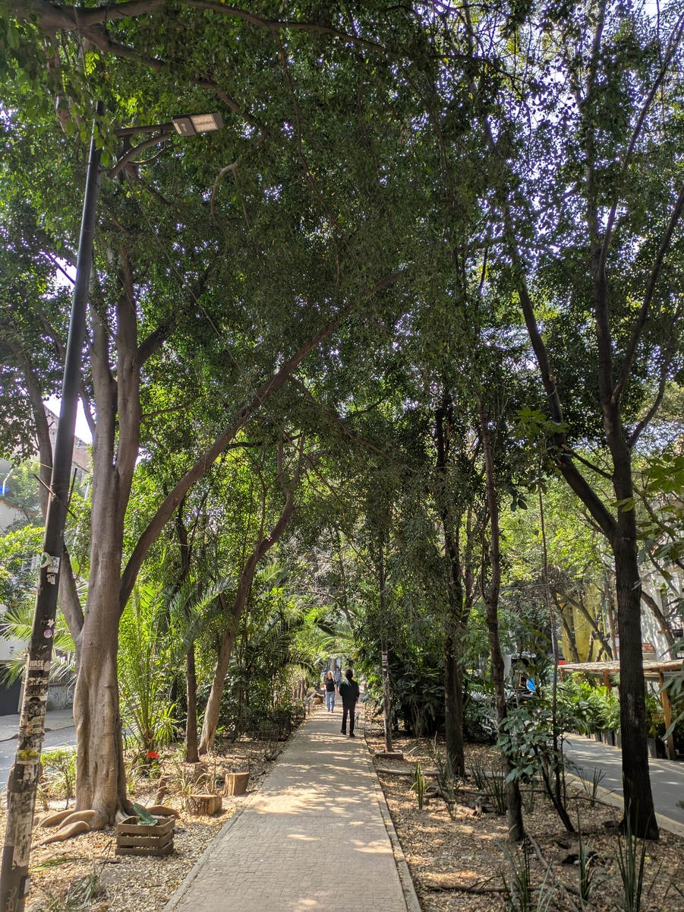
*Taking a stroll in the neighborhood of Condesa*

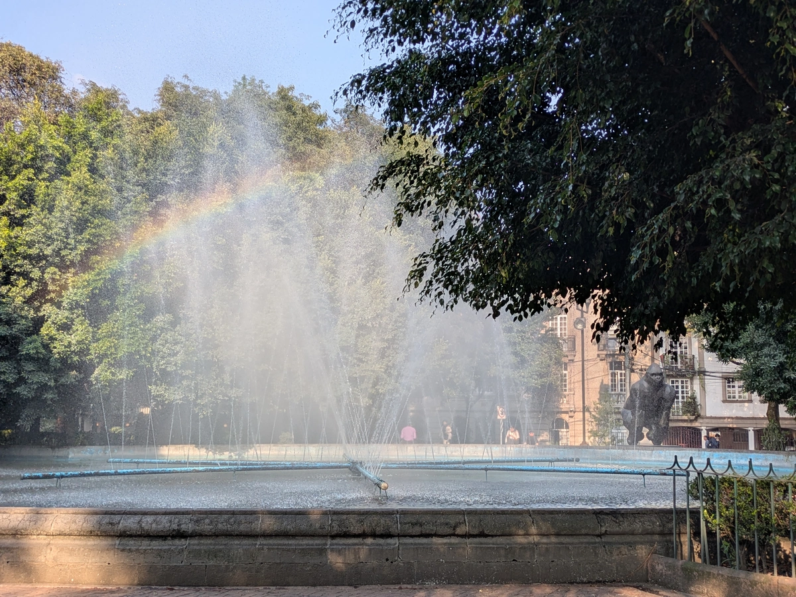
*The fountain at Plaza Luis Cabrera*

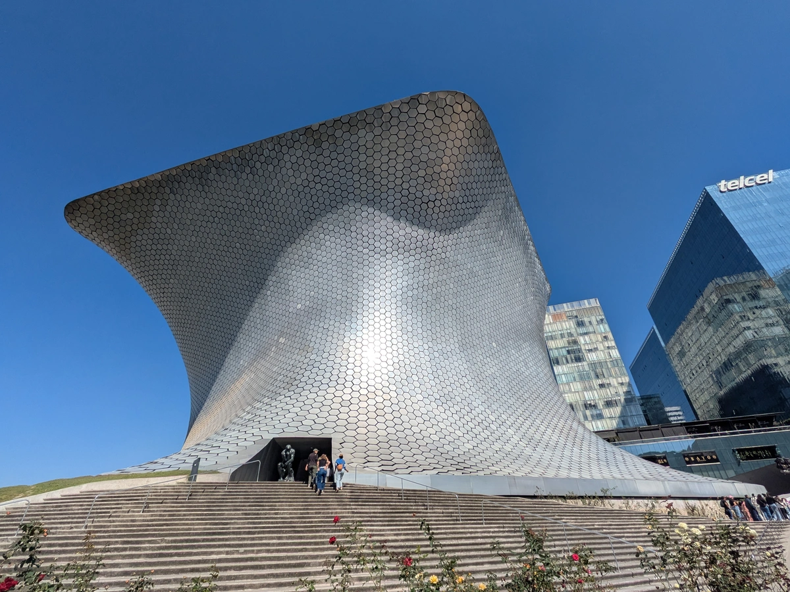
*Soumaya Art Museum*

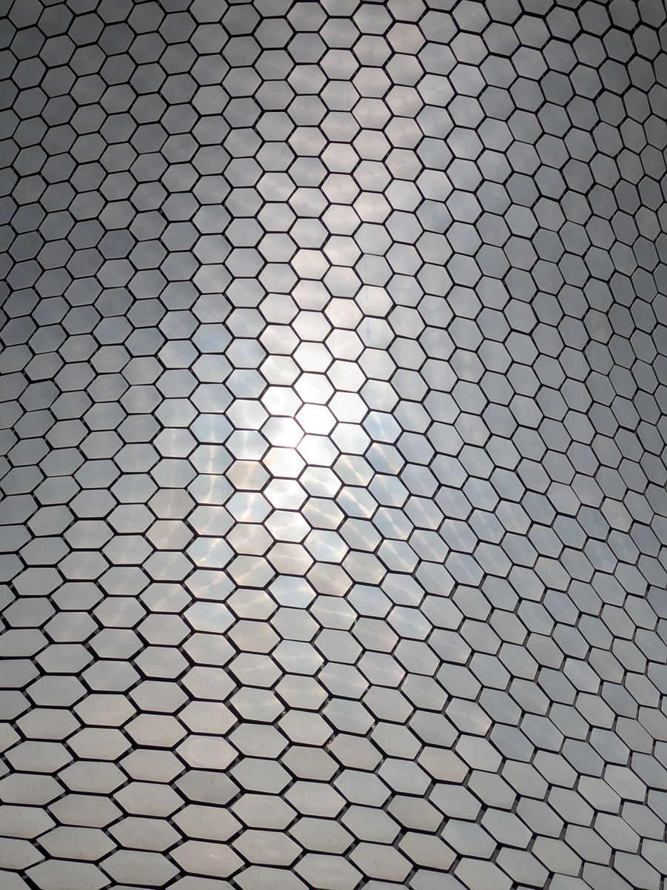
*Details of the tiles*

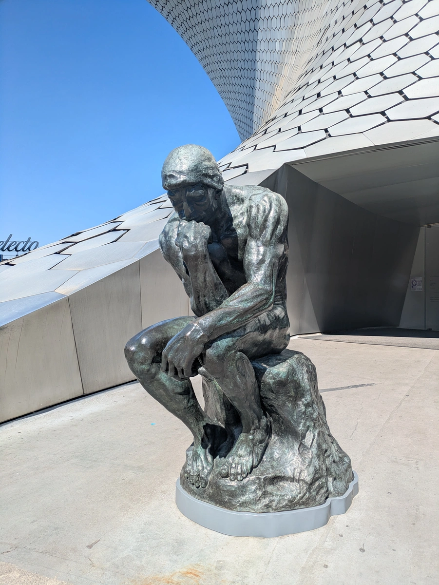
*Entrance to the museum*

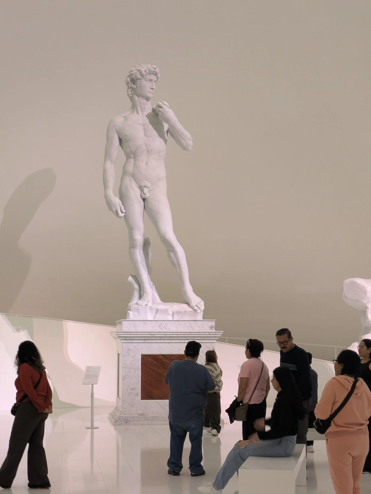
*Replica of David*

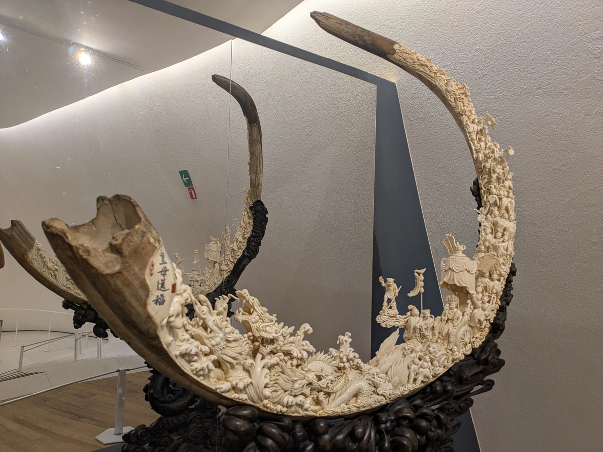
*Chinese husk sculpture*

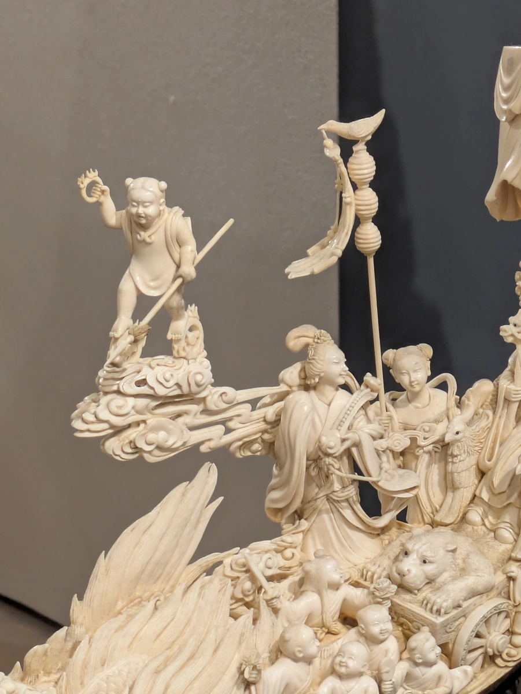
*Amazing detail!*

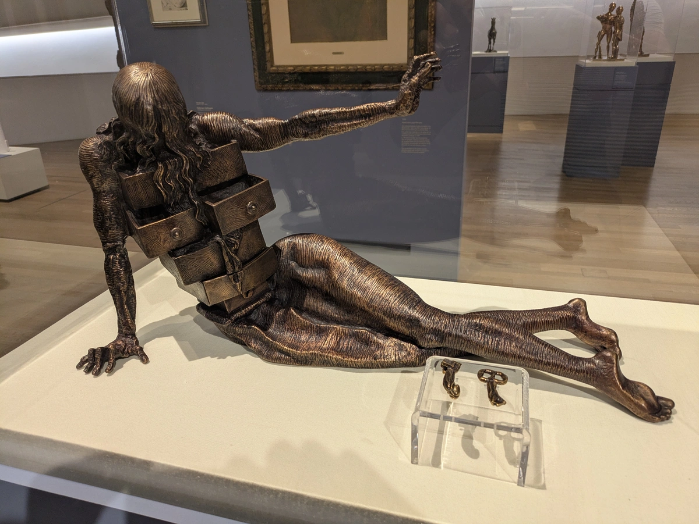
*Dali sculpture*

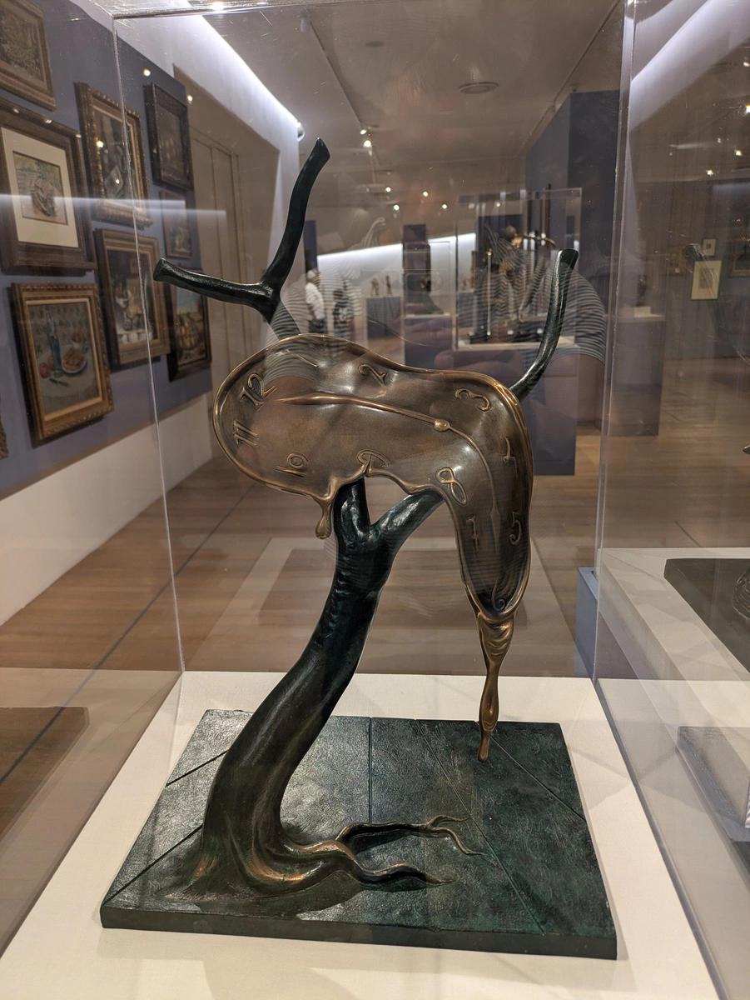
*Another Dali sculpture*

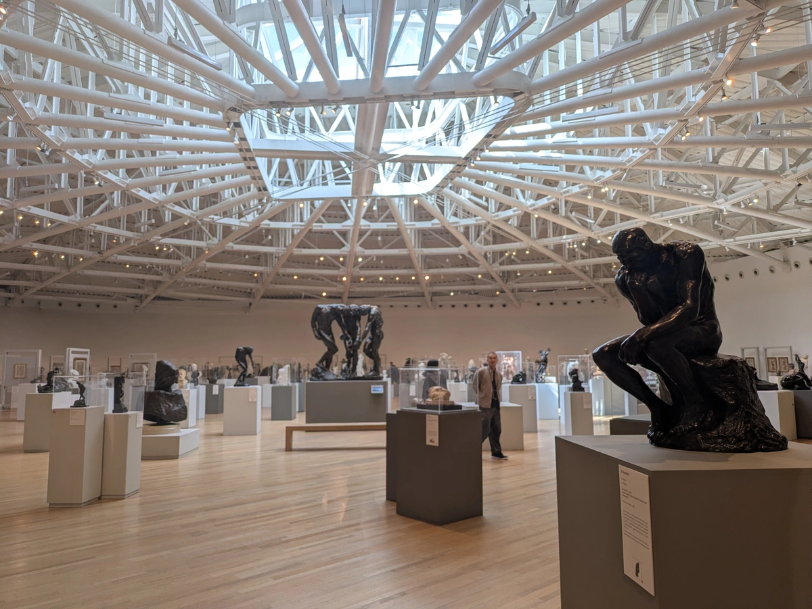
*Top floor of the museum*

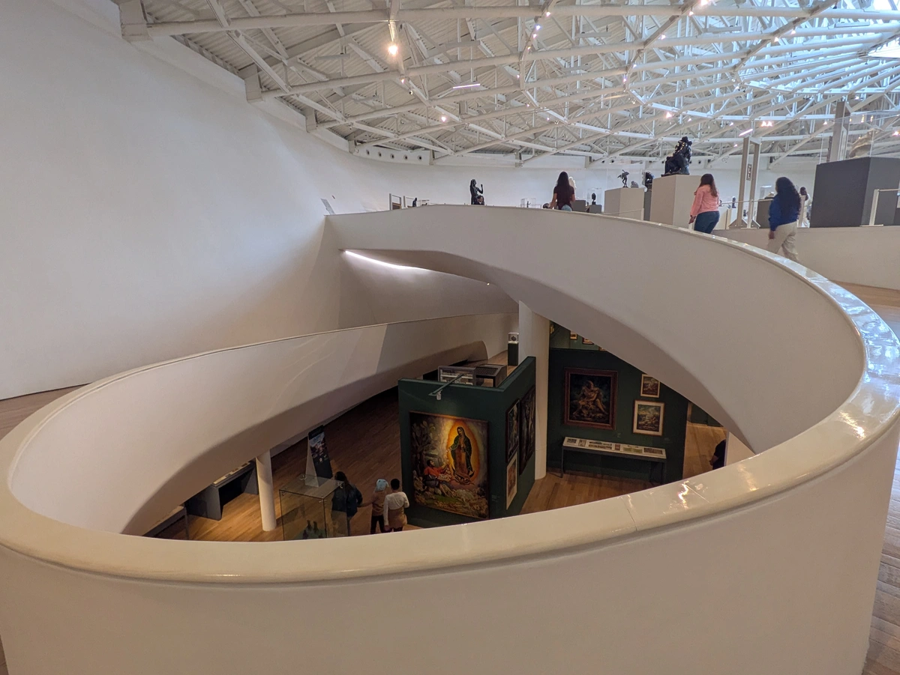
*Cool architecture*

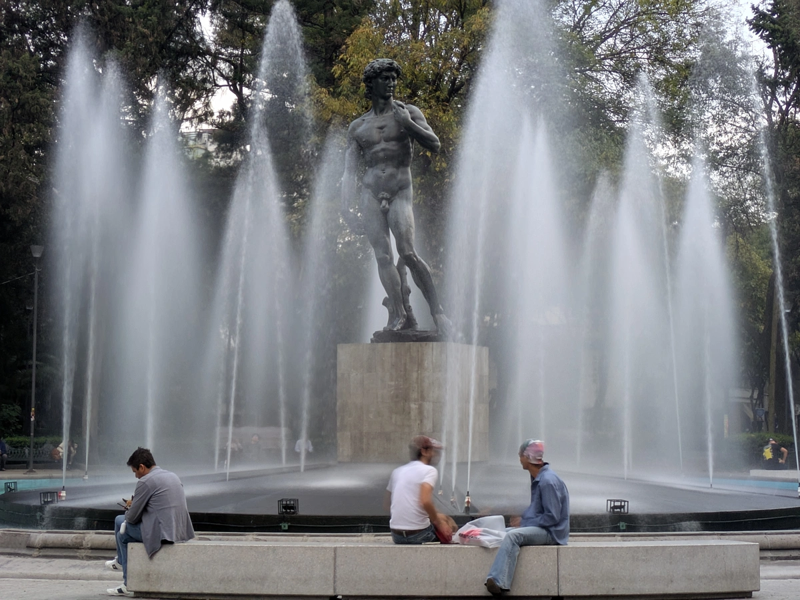
*Río de Janeiro Plaza*
